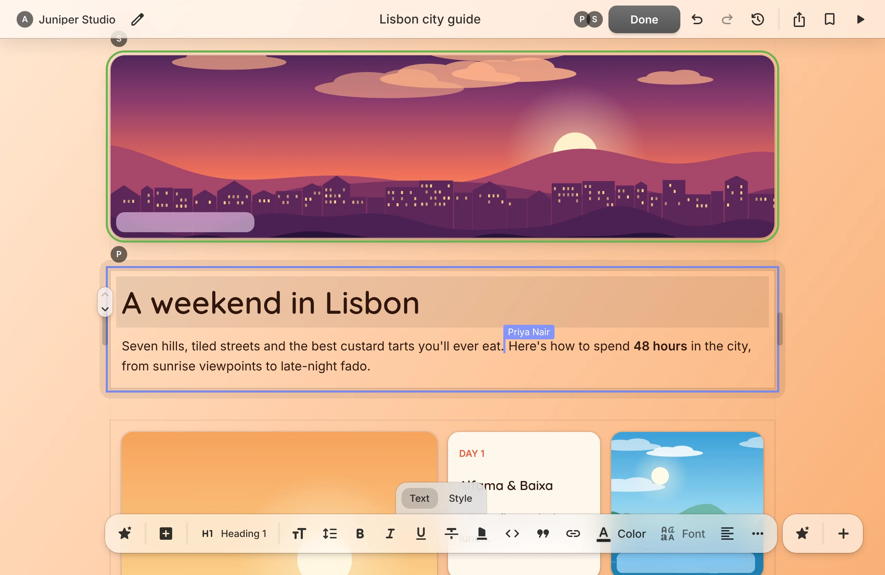
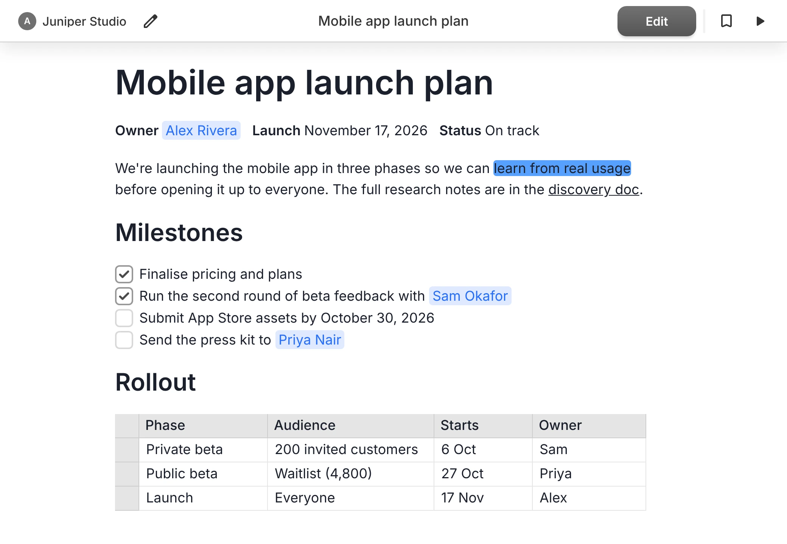
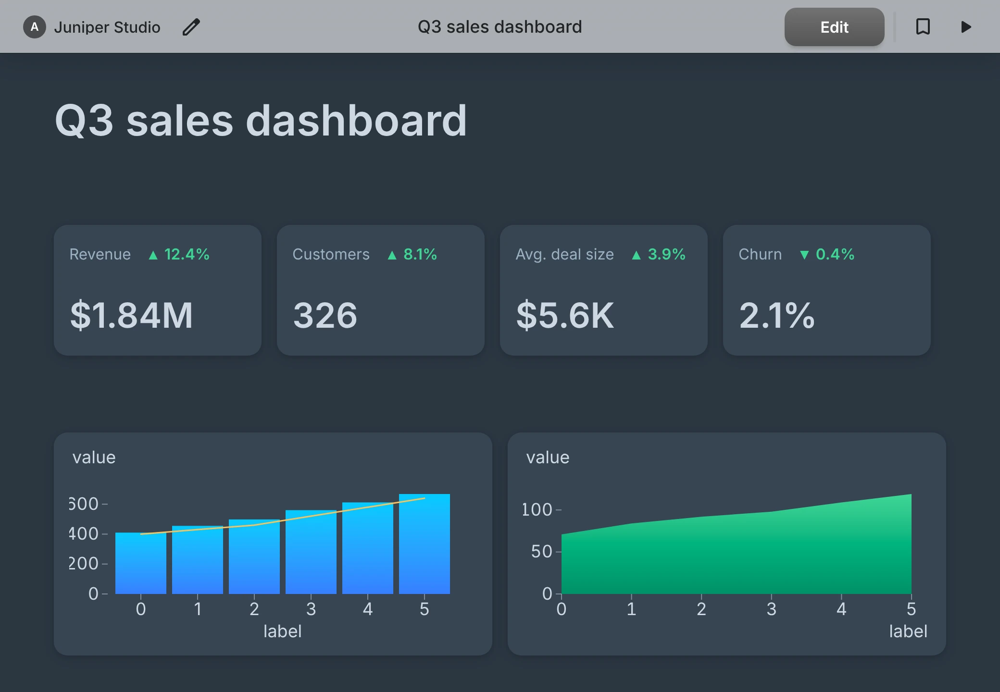
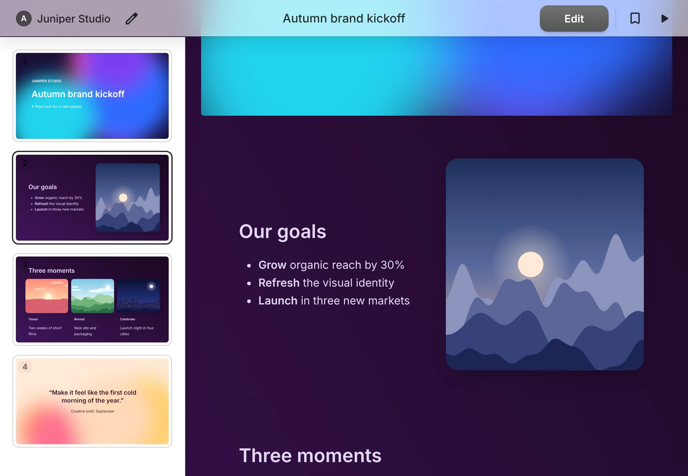
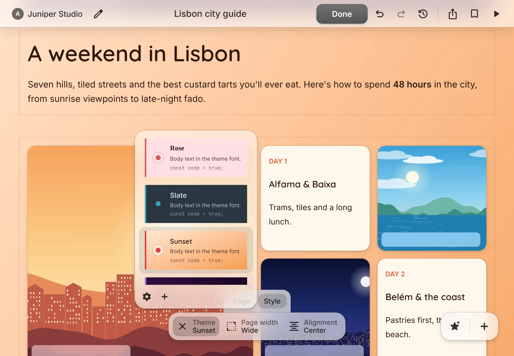

# Tiles

Tiles is a collaborative editor for building pages that look great and do more than plain documents: guides, presentations, dashboards, notes, portfolios, landing pages and more.

<p align="center">
  
</p>

Pages are made of **tiles**: blocks of text, images, videos, links, tables and charts. Drag them around, group them into sections, pick a theme and share the result.

## Features

- **Visual editing.** What you see is what you get. Switch between view and edit modes, and drag, drop and resize tiles directly on the page.
- **Three page types.** Start from a document, a presentation or a blank page.
- **Flexible layouts.** Arrange tiles in grid, horizontal, vertical, freeform, calendar or map sections.
- **Rich text.** Headings, lists, checklists, quotes, code blocks with syntax highlighting, mentions, dates and dropdowns.
- **Tables and charts.** Keep data in tables and plot it as bar, line or area charts.
- **Realtime collaboration.** Edit a page with others and see their cursors and selections as they work.
- **Themes and styling.** Apply a theme to a whole page or a single tile, then adjust colors, gradients, fonts, frames and animations.
- **Dock zones.** Pin tiles to the edges of the screen so they stay in view.
- **AI assistance.** Describe what you want and let AI write text, generate images and build sections.
- **Sharing and history.** Invite people to a page, publish it with a public link, and restore earlier versions.

## A closer look

<table>
  <tr>
    <td width="50%" valign="top">
      
      <p><b>Documents</b><br>Write with rich text and embed tables, images and other tiles alongside it.</p>
    </td>
    <td width="50%" valign="top">
      
      <p><b>Dashboards</b><br>Combine key figures, tables and charts on one page.</p>
    </td>
  </tr>
  <tr>
    <td width="50%" valign="top">
      
      <p><b>Presentations</b><br>Lay out slides freely, then present them full screen.</p>
    </td>
    <td width="50%" valign="top">
      
      <p><b>Themes</b><br>Restyle a page in one click, or create your own themes.</p>
    </td>
  </tr>
</table>

## How it's built

Tiles is a TypeScript monorepo managed with `pnpm`.

| Package               | Description                                                              |
| --------------------- | ------------------------------------------------------------------------ |
| `web`                 | Web frontend, built with Vite, Web Components and a custom JSX runtime.  |
| `api`                 | API server, built with Node, tRPC, Prisma and PostgreSQL.                |
| `doc`                 | Document schema and utilities shared by the frontend and the API.        |
| `jsx`                 | The JSX runtime used by the frontend.                                    |
| `reactivity`          | The reactivity library used by the frontend.                             |
| `fonts`               | Font registry, and the script that syncs fonts to Cloudflare R2.         |
| `env`                 | Environment variable registry.                                           |
| `image-upload-worker` | Cloudflare Worker that handles media uploads.                            |
| `dev-cdn`             | Development-only Cloudflare Worker that serves uploaded media and fonts. |

Rich text editing is built on [ProseMirror](https://prosemirror.net), and realtime collaboration on [Yjs](https://yjs.dev) and [Hocuspocus](https://github.com/ueberdosis/hocuspocus).

## Development

Tiles is developed in a [dev container](https://containers.dev). Opening the project in the container installs dependencies, creates the database and seeds it with test data.

### Local DNS setup

The development environment uses `.tiles.test` domains. To resolve these locally, set up dnsmasq:

1. Install dnsmasq:

   ```sh
   brew install dnsmasq
   ```

2. Configure wildcard resolution for `.tiles.test` domains:

   ```sh
   echo "address=/tiles.test/127.0.0.1" >> $(brew --prefix)/etc/dnsmasq.conf
   ```

3. Start dnsmasq:

   ```sh
   sudo brew services start dnsmasq
   ```

4. Configure macOS to use dnsmasq for `.test` domains:

   ```sh
   sudo mkdir -p /etc/resolver
   echo "nameserver 127.0.0.1" | sudo tee /etc/resolver/test
   ```

Local SSL certificates are automatically generated by Caddy and trusted on first run.

### Running commands from the host

To run `pnpm` commands from the host (outside the container), install [direnv](https://direnv.net/):

```sh
brew install direnv
```

Add the direnv hook to your shell (e.g. for zsh, add to `~/.zshrc`):

```sh
eval "$(direnv hook zsh)"
```

Then allow direnv for this project:

```sh
direnv allow
```

You can now run `pnpm` commands directly from the project root and they will be forwarded to the container.

### Running the app

Start the development servers:

```sh
pnpm dev
```

Then open `/sign-in/test-user` in the app to sign in as a test user. This route only exists in development.

### Scripts

- `pnpm dev`: Start the development servers.
- `pnpm check`: Run all checks (types, linting, formatting and unit tests).
- `pnpm test`: Run the unit tests.
- `pnpm test:e2e`: Run the end-to-end tests.
- `pnpm storybook`: Run Storybook for UI component development.
- `pnpm format`: Format files.
- `pnpm db:push`: Create the database schema.
- `pnpm db:seed`: Seed the database with test data.
- `pnpm generate`: Generate types for all packages (e.g. Prisma client, Cloudflare workers).
- `pnpm fonts:sync`: Sync fonts to R2.

### Dev containers

If using Git worktrees with dev containers, you must enable relative paths:

```sh
git config worktree.useRelativePaths true
```

This ensures worktree references work correctly inside the container.
